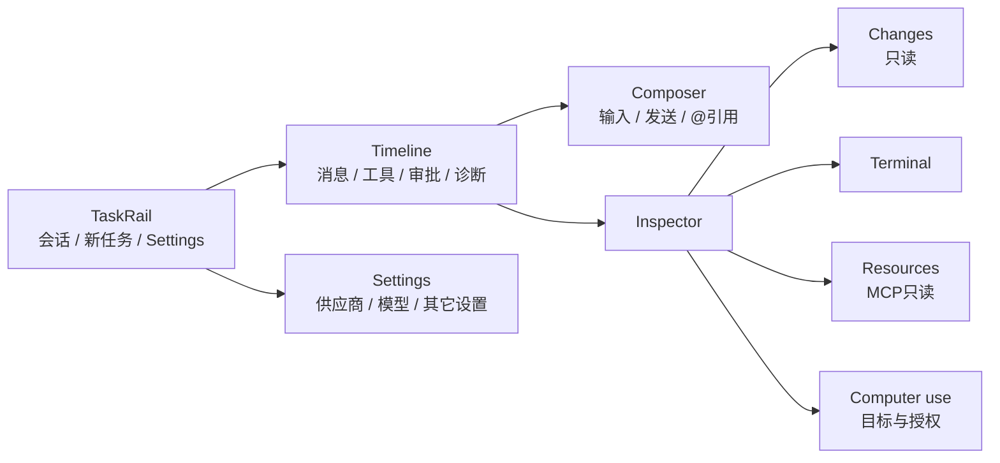

# Desktop 产品与交互规格

> 更新：2026-10-22。现行视觉与交互合同见 [GUI 设计](../gui-design.md)，未闭合验收见 [ROADMAP](../ROADMAP.md)，工程约定见 [AGENTS.md](../../AGENTS.md)。

## ADR-057：UI-3 思考投影与会话身份（2026-09-08）

状态：**Accepted**。

- **GUI API 1.14**：复用 live `AppEvent::ThinkingDelta`；历史新增 `TimelineItemKind::ThinkingDelta` 与可选 `message_id` / `thinking_text`。每个持久事件仍只对应一条 wire 条目，`MessageCommitted` 的正文与思考同载于 `AssistantMessage`，共享 reducer 再拆成显示行，不改变磁盘事件 schema 或 SQLite 版本。
- **合并与降级**：reducer 按 run/message/正文或思考维度合并有序增量，committed 全文替换累积体并阻止迟到增量重复追加；思考保留首次增量的 sequence/timestamp，迟到增量只可前移已有思考行，不恢复隐藏内容；分页、live 和重放收敛。Host 对 API <1.14 的历史响应移除新 kind 与新字段，保留原 `next_sequence` / `head_sequence` / `complete`，包括整页被过滤时的游标。
- **可见范围**：只投影可见 `Thinking` 文本，排除 redacted 文本、reasoning signature、encrypted content 和 protected blob reference。Desktop 以稳定的 run/message 锚点显示默认收起的「思考」摘要；鼠标、Enter / Space 与 AX 共享展开状态，收起时 AX 不暴露正文。无权威耗时就不显示时长。
- **Canonical Provider 契约**：`CanonicalModelRequest.session_id: Option<SessionId>` 缺省为 None 且不序列化空值，旧请求仍可解码。真实 `SessionTurn` 覆盖请求会话身份；主请求、工具续轮、自动/手动压缩及自动命名沿用真实会话，`trace_id` 保持原含义，Engine 无 Provider 名特例。
- **OpenCode Go 请求头**：仅该 API-key 通道在 Chat / Responses 两条传输路径把可用的 canonical session ID 映射到 `x-opencode-session`；每次请求重新取值，其他通道不发送。非法 header 值在发网前返回脱敏 `InvalidRequest`，不把身份塞进请求 body 或配置扩展。

## ADR-054：OPT-2 会话生命周期与自动标题（2026-09-05）

会话生命周期与自动命名使用 GUI API 1.11；wire 形状以 golden / typegen 为准。

- **D1 `SessionCreate.workspace_id` 改可选（since 1.11）**：wire 上字段可缺省或显式 `null` → Host 落盘 `workspace_id = NULL`，归 Unassigned；显式传值行为不变。无项目会话不获得任何 workspace 授权面：文件类工具按现有 Policy 对无 workspace 会话 fail-closed，只适用于问答等不碰仓库的任务。
- **D2 `SessionRename{session_id, title}`**：两字段必填；title trim 后为空为结构化错误，不写盘。写盘成功后回执 Data（session_view，即写后状态）。
- **D3 `SessionArchive{session_id, archived: bool}`**：两字段必填。归档后 `list_sessions`/snapshot 隐藏；归档不删除事件与投影，`SessionOpen` 仍可读；wire 保留 `archived: false` 反向写口，本阶段不提供永久删除，Desktop 只暴露归档入口。
- **D4 命名模型与自动标题**：Global 配置 `naming_provider` / `naming_model`（分层与 `default_provider`/`default_model` 相同；凭证仍只进 auth backend）。未配置则不自动命名，不用启发式冒充模型命名。会话标题仍为占位名（`New session`）且 Run 达成功终态时，Host 用命名模型做一次无工具一次性补全；成功才写回标题，失败/超时保留占位名。Settings 提供四默认角色的选择入口。
- **D4a 自动命名并发收口（2026-09-06 审查修复）**：读取素材只读重放，不决议 pending approval、不追加 Agent 事件；命名任务快照依赖后释放 Core 锁，装配、目录解析、补全共用 20s 超时。写回前确认命名配置仍有效，以单条条件 UPDATE 校验占位标题并写入，避免覆盖手动改名；改名/配置清除期间返回的旧结果丢弃。
- **D5 `AppEvent::SessionMetaChanged{session_id, title, archived}`**：改名/归档/自动标题写回后由 Host 经 EventHub 广播；Desktop 收到后重取 snapshot，列表即时反映写后状态。当前会话归档时一并收口 Composer、分页、Changes 与 Terminal workspace 草稿；重复刷新保持当前 UI scope。新建会话严格使用创建回执的 session_id，不从列表顺序猜测。

Markdown、工具折叠与 Run 终态呈现见 [GUI 设计](../gui-design.md#ui-3-时间线更新2026-09-08进行中)；新增面板与剩余验收见 [ROADMAP](../ROADMAP.md)。

## 1. 产品定位

Pawork Desktop 是本机单窗口 GPUI Agent 工作台。它只负责呈现、输入和用户控制，通过 `pawork-client` 连接 `pawork gui serve`；业务状态、Provider、数据库、工具、Git、PTY 与安全决策均留在 CLI/AppCore 宿主。

默认窗口为 1440×1024，当前只有深色主题。视觉 token 与组件值见 [GUI 设计](../gui-design.md#32-共享视觉合同)，实现以当前源码为准；本文只定义产品流程和可验收行为。

## 2. 信息架构

| 区域 | 必须呈现 | 当前限制 |
| --- | --- | --- |
| TaskRail | 会话/任务条目、新任务、项目范围、`Add project…`、选中态、长标题截断；UI-2 悬停 / 聚焦行操作 | 项目通过系统目录选择器和 Host `workspace_add` 注册；100%：宽窗 288px、1080–1279 为 240px；150% 时 320px。 |
| Timeline | 用户/助手/工具/诊断/Run 状态、流式内容、审批卡、fork 边界、回到底部 | 变高虚拟化；菜单锚点卸载、follow-scroll 与千级事件仍需按风险定向复验。 |
| Composer | 多行输入、发送、附件/`@` 引用反馈 | host 已展开 `@token`；无模糊候选浮层。系统 IME composing 已取得本机证据；多行粘贴与草稿有定向测试，跨平台输入仍需专项验收。 |
| Inspector / Changes | OPT-4b 起默认折叠（Header `inspector-expand` 重开）；顶层 Changes/Terminal/Resources 与二级 Files/Summary 分层；DiffView；折叠态 Header ActivityPopover | 只读；无 stage/unstage/hunk 命令。 |
| Inspector / Terminal | 紧凑标签栏与直接输入的终端窗口；自动启动、自动适配视口、行内光标、粘贴及控制键；流式输出与 live/snapshot 终态 | 无独立输入栏、发送或手动尺寸控件；创建仍需 Policy；支持 shell 行编辑，尚不是完整 VT emulator。关闭标签走真实 `terminal_close`。 |
| Inspector / Resources | MCP server/tool 状态、刷新 | 只读；没有已加载 AGENTS.md/Skills 分区。 |
| Inspector / Computer use | computer-use 目标状态卡（授权 / 绑定 / 占用 / 暂停 / 能力矩阵）与授权管理：允许一次、本 run 允许、撤销 | 数据只来自 Host 登记事实（grants ∪ 绑定窗口）；授权仅当前 run、不持久化；按钮 gate 与 AX 同源，旧 Host（GUI API <1.27）显示版本要求占位。 |
| Settings | English / 中文 Settings Rail + 全宽可滚动内容列（两侧 32px）；Models & providers、Subagents、Network、Approvals、Tools & MCP、Terminal、Appearance、Advanced、About | 九页保持现有能力与 gate；Provider 自然高度概览、账号 / 模型 / quota 展开区与列表后的四默认角色。UI-06 统一标题 24/32、说明 14/22、名称 / 动作 14px、来源 12px，网络 / shell 输入限 320px，长表单与动作换行；审批行随内容撑高，外观 / 子代理 / 强度用中性选中与勾选，诊断值用等宽文本。角色菜单 AX 打开后真实聚焦触发器，Esc 归焦；MCP 错误分摘要与完整原文。Host 回执、stale 禁写、Secret 缓冲及本地 Appearance / Advanced 离线语义沿用；真实认证 / quota 全状态矩阵与用户签字仍单独登记。 |

## 3. 连接与状态模型

### 3.1 启动

1. 用户可运行 `./scripts/start.sh` 构建并启动正式 Host/Desktop；脚本使用独立实例且不加载测试数据。也可手动启动 `pawork gui serve`。
2. Desktop 按 `--socket` / `--instance` 或默认数据目录发现 endpoint/token。
3. `pawork-client` 完成 token proof、API 版本协商和 capability 握手。
4. 客户端 ack/subscribe，再请求 snapshot/resume 建立 projection baseline。

缺 socket、缺 token、认证失败、版本无交集或 capability 不满足时必须显示断线/错误态；禁止无认证或降级绕过。

### 3.2 稳态与重连

- host 空闲超时为 30s；Desktop 事件泵约 15s 无事件发送 heartbeat。
- 任意入站帧刷新 host 活跃时间；heartbeat 失败进入既有断线路径。
- 断开 Desktop 不取消正在运行的 Run。
- Reconnect 后通过 resume 或 snapshot fallback 恢复；同一 session 切 branch 必须清空旧 timeline/seen/tombstone/tool anchors 后建立新 baseline。
- request error 只交给匹配请求；连接级 error 进入全局状态，不能被事件流误吞。
- 自动 Command/Query id 包含每个 `GuiClient` 连接实例的 namespace；Host 重启后即使 `client_id` 重新从 `client-0` 计数，也不能撞上持久化幂等账本里的旧请求。

## 4. 交互需求

### 右侧浏览器（2026-09-16）

用户通过面板「+」/ 空态 / Cmd+K 打开手动浏览器；地址栏、前进后退、刷新 / 停止与真实错误已接线。每任务一页、隐藏保留、关闭释放；站点数据使用隔离的非持久 WebKit profile。首版 macOS 系统 WebKit，HTTP(S)（含 localhost）导航；新窗口链接同页打开。聊天自动操作经 Host Policy / 审批执行；截图、下载、多网页标签和跨启动恢复未实现。浏览器实现由独立 [pawork-browser](crates/browser.md) 提供，Desktop 只负责布局、输入和任务归属；不改 GUI Protocol / Core。未闭合验收见 [ROADMAP](../ROADMAP.md)。

| ID | 要求 | 状态 |
| --- | --- | --- |
| DESK-01 | 用户能添加/选择真实项目并新建/切换会话，选中态与标题在长列表中可辨认。 | 项目选择、新建和切换生产入口已实现；多项目集合与 Session 归属已持久化并通过重启复验。 |
| DESK-01a | 全局 New task 直建无项目会话（Unassigned），会话行右侧可改名/归档；配置命名模型后占位标题会话在 Run 成功后自动命名。 | ADR-054 已实现（API 1.11）。归档仅隐藏不删除；无项目会话以空授权面运行问答，文件类工具 fail-closed，Composer 显示 No project 诚实提示。 |
| DESK-02 | Timeline 能按确定顺序投影历史和 live 事件，去重且不跨 Run 串线。 | 已实现；共享 reducer/golden。 |
| DESK-03 | 流式输出时默认跟随底部；用户上滚后脱钩，显式回底后重挂。 | 生产逻辑已实现；长会话与性能按风险定向重验。 |
| DESK-04 | 工具请求以审批卡呈现 ApproveOnce/ApproveForRun/Deny；取消动作可见。 | 生产逻辑已实现；审批须显式决策，无默认允许。 |
| DESK-05 | Fork 只在 reducer 标记的闭合 Run 边界开放，动作入口再次校验。 | 已实现。 |
| DESK-06 | 同时只打开一个菜单；Escape/外点关闭；浮层 occlude 防滚轮穿透。 | 已实现；本机 scope / model / Activity 及键盘关闭回焦已复验。 |
| DESK-07 | Composer 支持中文 IME、多行粘贴、Shift+Enter 与明确发送。 | 已实现；paste / Shift+Enter 有定向回归；系统 IME 按真实平台验收。 |
| DESK-08 | Inspector 七种工具与文件 / PTY 共用滚动标签，Side / Center 切换保留任务；进入 / 展开 / 会话切换 / Run 终态 / 刷新时拉取正确数据。 | 主路径已实现；Changes / Resources 四通道刷新与实测 AX 见 UI-05；真实运行状态矩阵按环境验收。 |
| DESK-09 | 断线态可 Reconnect，Run/会话不因 UI 断线丢失。 | 重连路径已实现；项目与 Session 归属跨重启已复验。 |
| DESK-10 | 1080×720 下 Composer、状态栏和 Header Activity 触发器仍可用。 | 已实现；宽窄窗与三档字号按当前窗口验收。 |
| DESK-11 | 可见结构和控件具备稳定 AX identifier、正确 role/name/value/state/action；AX 操作复用鼠标/键盘的业务 gate。 | ADR-042 macOS bridge 已实现；主路径可经 AX 驱动，Windows/Linux 平台仍未验收（VoiceOver 验收已于 2026-09-04 按用户要求移出范围）。 |
| DESK-12 | Settings 从 TaskRail 进入；Host capability 驱动业务页，本地外观页驱动当前 Desktop 字号；本地高级页提供安全连接诊断；关于页呈现当前 Host 权威元数据；返回时保持工作台状态，secure input 不泄漏 AX value。 | SET-3～SET-6g 已实现。外观页在离线态仍可达，三档按钮/快捷键/AX Press 共享 `TextScale`；高级页的握手摘要只在当前连接存活时可用，runtime ID 不冒充配置 instance，Reconnect 与既有 handler 同源；About 的 render/AX 共用 Connected + 非空 `host_data_dir` gate，断线清空并回退高级。当前九页含子代理页；真实账号端到端矩阵与 E4 签字见 [settings.md](settings.md)。 |

### 4.1 当前可见合同

- Timeline 使用 880px 居中可读列，两侧至少各留 28px；16px / 26px 正文、32px 消息间距，用户浅底卡片与 36px 轻量工具摘要区分层次；独立完成页脚前留 12px。
- TaskRail 项目头计数 / 「+」与任务行改名 / 归档共用 64px 尾槽（两格 32×32，右缘 8px）；Header 为 medium；24px StatusBar 使用 12px 字阶和窄窗裁切。已连接且无选中任务时，Composer 可直接发送并归为 Unassigned 无任务对话。
- UI-4 Composer 的 input / 模型 / Send/Cancel 共属居中卡片（至少 110px、最高 220px），项目与上下文移到卡片下方；缺值仍如实显示 unavailable。留白、字号与交互见 [GUI 设计](../gui-design.md#ui-4-输入栏更新2026-09-08)。
- Changes 文件行使用稳定前后槽；DiffView 的只读路径 header 位于横滚外，24px 语义 gutter 与中性正文分离；ActivityPopover 内容宽 320px，内容高随 100%/125%/150% 为 144/180/216px，外框包含 8px padding 与 1px border，摘要可见且保持 capability honesty。

UI-05 工作面板：标题 16/24、控件与主项 14/20、说明 / 错误 14/22、辅助 12/18，面板空态顶部留 24px。Changes / Resources 鼠标、Enter、Space 与 AX 共用刷新 gate；Resources 先显示本地化摘要，技术详情保留完整原文，查询失败保留并标注旧列表。两页 AX 使用真实布局与焦点，离屏动作不发布；Changes Summary 标签列随字号缩放，Browser 长标签截断且关闭 / 新建入口可达，无 tab 仍可通过既有「+」创建；Terminal 以 Host runtime state 显示退出 / 停止 / 异常退出提示，断线仍优先显示离线。各工具的专用布局与真实状态验证边界见 [GUI 设计 §8](../gui-design.md#8-工作面板) 和 [方案交付记录](../plan/ui-2026-10-22.md#9-进度记录)。

UI-5 设置壳与七个非供应商页沿用 UI-1 token，改为 40px 导航、36px 动作与全宽分区布局；页内命中框按 GPUI 实际布局和滚动视口同步，离屏项不暴露动作。原有设置持久化、可用性与断线 gate 不变，供应商页产品改动属于 UI-6。规格见 [GUI 设计 UI-5](../gui-design.md#ui-5-设置更新2026-09-08)。

UI-06（2026-10-22）完成设置九页的字号与自然换行迁移；外观样例新增 12/18 来源，AX 顺序与像素一致。31 项去重既有定向回归与正式 build 通过，原生窗口覆盖和待验状态见 [优化方案 §9](../plan/ui-2026-10-22.md#9-进度记录)。自动检查与原生抽查不等于用户人工验收，未归档。

UI-07（2026-10-22～23）统一 Plan / Goal / Recording / Video / Drawing / Usage 的 20/28 图标标题、14/22 说明、24px 内边距及滚动表单；动作可换行，键盘焦点滚入视口，AX Focus 只移焦、Press 激活并使用实测可见框。Plan 按版本 / dirty / review 状态突出当前动作；Goal 预算 / 轮次可堆叠、转向另组；Recording 分操作、预览与项目技能保存阶段，回执紧邻保存；Video 保留空值清除和保存校验；Drawing 保留白画布与原无笔画 gate；Usage 中性勾选筛选、14px 对齐汇总，unknown / 0 / 币种 / 分页沿用。4 项既有定向回归与正式 build 通过，最终产物完成中英文 24 组排版及键盘 / 校验状态抽查；真实局部状态与用户人工待验，未归档。默认尺寸、三字号真窗覆盖和剩余状态分别见 [GUI 设计](../gui-design.md#辅助窗口显示) 与 [方案交付记录](../plan/ui-2026-10-22.md#9-进度记录)。

长模型名与搜索结果保留完整 tooltip / AX；模型候选行分开显示名称、Provider / 目录来源与能力。当前模型未列入已连接且已启用的对话候选目录时保留当前值并说明管理入口，不自动切换，也不新增发送 gate。附件预览、移除与关闭具有独立命中区及真实键盘 / AX 焦点。发送错误归发起草稿，重试 / 成功清除。MCP 状态、Changes 横向浏览、子代理回执和辅助窗口的显示合同见 [GUI 设计](../gui-design.md)，行为回归见 [desktop crate](crates/desktop.md#7-测试与验证资产)。

UI-08（2026-10-23）完成本轮统一复验与覆盖账，修正模型菜单 AX 高亮冒充焦点、长分支覆盖状态栏用量、附件预览 AX 零高度及关闭命中区过窄，阅读列比较后保留 880px 上限。5 项既有定向回归与正式 build 通过；主路径草稿 / 查找回焦 / 精确复制 / 面板阅读锚点及一次真实 GLM 5.3 只读 Run 已核。真实复杂状态、完整键盘 / VoiceOver、系统 IME 与用户人工验收分别保留待验，未归档；精确产物、覆盖配置及限制见 [方案 §9](../plan/ui-2026-10-22.md#9-进度记录)。

## 5. 键盘、IME 与可访问性

最低验收要求：

- Tab 顺序覆盖 TaskRail、Timeline 操作、Composer、Inspector/Header Activity 触发器和当前页主要控件；
- 焦点环清晰；hover 不是唯一状态表达；错误、审批和连接状态不只靠颜色；
- Escape 关闭菜单且不吞掉 Composer 的其他键盘语义；Enter/Shift+Enter 与 IME composition 明确区分；
- 菜单支持键盘到达、选择与关闭；长标题以 truncate + 可辨识上下文呈现；
- 长会话、长 diff 和窄窗不让主要操作不可达。
- AX identifier 与用户可见/可本地化 label 分离；disabled 控件不发布可执行 action，未知 action fail-closed；新增可见交互须同批补语义节点。
- 应用内字号支持 100% / 125% / 150%：`Cmd+=` / `Cmd++` 放大、`Cmd+-` 缩小、`Cmd+0` 重置；SET-6e 外观页提供同源三档按钮及当前值/AX selected。字号即时生效并保存到用户目录 `desktop.json`，重启恢复选择；150% + 1080×720 使用 320px TaskRail，Workspace 保留 760px。
- 主题为单一深色 palette，不读取系统显示偏好（Increase Contrast 支持已于 2026-09-04 移除）；GUI3-08 仅 oneshot 开合 / Switch 位移，无循环闪动，Reduce Motion 无渲染分支。

当前锁定 GPUI 0.2.2 不原生导出元素级 AX tree；ADR-042 已由 Desktop 显式 `AxTree` + AppKit 虚拟元素补救。菜单方向键、grouping/scope tab stop 与全局焦点等价路径已经存在；已知缺口为 Windows/Linux 平台 AX；VoiceOver 屏幕朗读与系统显示偏好验收已于 2026-09-04 按用户要求移出范围。

## 6. 只读与写入边界

- Changes 的 Files/Summary/DiffView/ActivityPopover 是只读投影；任何 stage/unstage/hunk 都需新增 protocol command、审批语义和 ADR，不得从 UI 直接调用 Git。
- Resources 只消费 `mcp_list`；无 host query 的“已加载规则”不能伪造占位数据。
- Settings 高级页只消费 Desktop 已有握手与连接本地事实；不显示 token/token path，不从 socket 推断 data directory/配置 instance，不 shell-out CLI，也不提供实例热切换。
- Settings About 已按 ADR-051 Accepted 落地：只在当前认证握手声明非空 Host data directory 后显示，原样呈现该路径；缺字段、仅空白字段或断线时隐藏并退回高级。路径不用于文件操作或 endpoint 反推。
- Composer「+」→「引用项目文件 / 引用图片」打开当前项目 Files；引用状态的文本文件及图片行将 `@"相对路径"` 加入草稿并返回输入框，保留既有正文，不自动发送。中文、空格与引号由 JSON 字符串编码。`@` 引用由 host `expand_at_refs` 解析：文本为独立 Text part，png/jpeg/gif/webp 为头标记 + Image part（8 MiB 上限），模型不支持图片时发网前拒绝；Desktop 不自行读取任意文件。模型菜单明确标注图像 / 搜索能力；搜索是否启用仍取决于 Host 配置。
- Terminal 只发协议命令；Desktop 不持有本机 PTY 服务。首次打开且无终端、无错误时自动创建，关闭面板保留 PTY。直接在输出区输入，Enter、Ctrl-C、Tab、方向键交给 shell，Cmd-V 按 shell 模式粘贴；IME 预编辑位于真实光标处，提交后才发送。没有独立命令草稿、发送按钮或手动尺寸控件。尺寸仅自动匹配视口，关闭标签经 Host 确认后移除；错误就地显示，Policy 拒绝保持 fail-closed。

## 7. 当前验收合同

当前执行入口只有 [AGENTS.md](../../AGENTS.md)。Settings 的专项行为与证据见 [settings.md](settings.md)。真实 Desktop 主路径至少覆盖：正式启动、添加真实项目、新建 Task、发送消息、文件写入与审批、Git Changes、Terminal 输入输出；不使用 fixture、seed、probe 或测试 profile 冒充通过。需要真实模型的功能验证使用 `glm-coding / glm-5.3` 或 `xai / grok-4.7`（当次 Host `--provider` / `--model`，先核目录、启用态与实际路由，不改持久默认）；口径见 [verification.md](verification.md) §2.1。

边界口径：

- `ui/mod.rs` 行数属于工程结构，不是视觉放行条件；
- 窄窗使用 240px TaskRail，150% 字号使用 320px；菜单锚点卸载和缺少完整 AX 语义均不作为可签字偏差；
- Desktop Changes 只读是当前协议边界，Git 写操作仍需 ADR，不得用假按钮补图；
- `@` 候选浮层和 Resources 规则分区只有 Host capability 存在时才可展示。

证据必须记录实际窗口状态、连接态、真实操作 trace、文件/Git/PTY/Provider 外部事实和实际执行的自动检查。三张阶段目标设计图、Settings 真窗口与发布状态均需单独记录，不能由功能测试互相替代。

## 8. 补充交互合同

### OAuth 登录详情交互

授权等待区提供打开浏览器、复制完整授权链接、复制可选验证码；登录详情支持鼠标拖选与键盘复制，长 URL 可横滚，复制按钮显示反馈；终态收起动作。xAI Device Flow 与无验证码的 PKCE 共用 Host 返回数据，不硬编码供应商。只读字段无 AX SetValue，API key secure 输入维持掩码与复制保护。交互规格见 [GUI 设计](../gui-design.md)。

### 聊天控制 Terminal / Browser（2026-09-16）

聊天工具已接入 Host 权限和审批，Terminal 与手动面板共用 PTY，Browser 通过 GUI 1.18 请求/回执操作当前任务系统网页。调用与返回值沿用工具事件持久化，重放不触发动作。接口见 [app](crates/app.md)、[browser](crates/browser.md) 与 [Desktop](crates/desktop.md) Spec。

### 右侧文件浏览与编辑（2026-09-16）

Files 工具以懒加载目录树浏览当前项目、打开多份已有文本、修改并显式保存。正文占满文件区高度，右侧目录树可收起，文件名筛选覆盖已展开的目录（忽略大小写）；每份文件直接与终端、浏览器等内容共用顶部标签栏，文件区只保留路径和操作。Markdown 默认预览，可切换源码编辑，预览包含当前未保存修改。每份文件保留独立草稿与未保存标记；不同项目隔离，切换任务 / 标签及收起工具保留草稿。⌘S 与按钮等待 Host 回执，外部版本冲突拒绝覆盖；重新载入、关闭未保存文件标签或窗口先确认；关闭后台文件保留当前页，关闭最后一份文件回到仍打开的工具。支持 UTF-8、无 NUL、≤128 KiB 的已有普通文件。协议版本 GUI 1.19，全部 IO 经 CLI Host；不直接从 Desktop 读取文件。新建 / 删除 / 重命名、语法高亮、自动保存不在本批。见 [GUI 设计](../gui-design.md#14-右侧文件浏览与编辑2026-09-16)。

Composer「+」在首页与无项目任务也可使用本机文件 / 图片附件及网络搜索。系统选择器明确选择文件，Desktop 后台有界读取，经 API 1.22 分块上传后由 Host 校验并转换为消息内容；不注册用户目录、不改变项目归属。附件名称与移除操作随任务草稿保存，失败保留，成功接收清除；搜索三态为沿用默认 / 本轮开启 / 本轮关闭。能力不匹配时提示选择支持的模型。项目相对引用保留独立入口。未闭合验收与候选见 [剩余工作与验收](../ROADMAP.md)。
